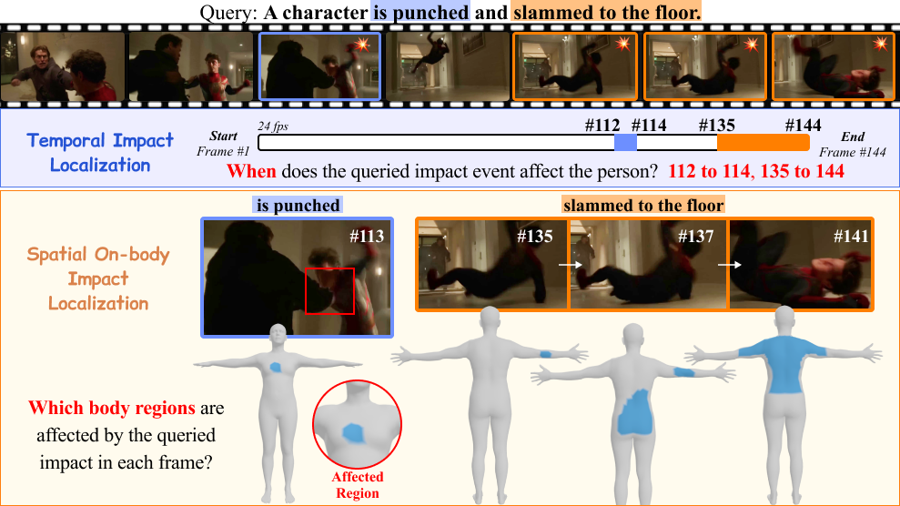

# HAPACT
> HAPACT: A Benchmark For Human-Centric Physical Impact Localization in Movies
>
> [Youngrae Kim](https://www.linkedin.com/in/youngrae-kim-59a47a139/), [Yejin Jang](https://www.linkedin.com/in/yejin-jang-445778390/), [Eunho Kim](https://www.linkedin.com/in/eunho-kim-54059126a/), [Youjin Sung](https://youjinsung.com/), [Kun-Woo Song](https://www.linkedin.com/in/kun-woo-song-1557b2112/), [Sangpil Kim](https://kuaicv.com/professor/?theme=pub/antoniau0026hide_banners=true/), [Sang Ho Yoon](https://sanghoy.com/)
>
> *The Fortieth Annual Conference on Neural Information Processing Systems (NeurIPS), 2026*

[](https://hapact.hcitech.org/)  [](https://huggingface.co/datasets/HAPACT/HAPACT-Dataset)



This is the official repository for the [HAPACT: A Benchmark For Human-Centric Physical Impact Localization in Movies](https://hapact.hcitech.org/) (NeurIPS 2026).

## Dataset
The HAPACT dataset is available on [Hugging Face](https://huggingface.co/datasets/HAPACT/HAPACT-Dataset).

## Code
The implementation code and instructions can be found in the `code/` directory.

## Citation
If HAPACT contributes to your research, we would appreciate it if you could cite our paper:

```bibtex
@inproceedings{kim2026hapact,
    title={HAPACT: A Benchmark For Human-Centric Physical Impact Localization in Movies},
    author={Youngrae Kim and Yejin Jang and Eunho Kim and Youjin Sung and Kun-Woo Song and Sangpil Kim and Sang Ho Yoon},
    booktitle={Advances in Neural Information Processing Systems (NeurIPS)},
    year={2026}
}
```

## Website License
<a rel="license" href="http://creativecommons.org/licenses/by-sa/4.0/"></a><br />This work is licensed under a <a rel="license" href="http://creativecommons.org/licenses/by-sa/4.0/">Creative Commons Attribution-ShareAlike 4.0 International License</a>.